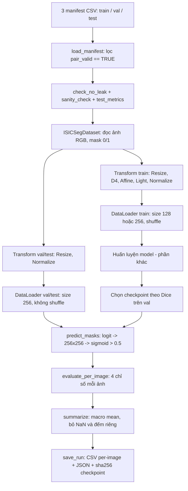

# NOTE: Tiền xử lý dữ liệu và bộ đánh giá

## 1. Output

Colab: https://colab.research.google.com/drive/159ZWRb8gGIy9cG9D4kHeVsCL0tX1cfEp?usp=sharing

| #   | Công việc                                                         | File               |
| --- | ----------------------------------------------------------------- | ------------------ |
| 1   | Tiền xử lý, tăng cường online và chuẩn hóa                        | `augmentation.py`  |
| 2   | Pipeline xử lý trước khi đưa vào mô hình cho ảnh và mask từng tập | `data_pipeline.py` |
| 3   | Bộ chỉ số đánh giá: raw Jaccard, Dice, Sensitivity, HD95          | `metrics.py`       |

## 2. Tổng quan pipeline

---

## 3. Module `augmentation.py`

### 3.1 Thứ tự biến đổi

| Tập        | Chuỗi biến đổi                                      |
| ---------- | --------------------------------------------------- |
| Train      | Resize → D4 → Affine → Light → Normalize → ToTensor |
| Val / Test | Resize → Normalize → ToTensor                       |

### 3.2 Resize

- Ảnh: nội suy **bilinear** (`cv2.INTER_LINEAR`).
- Mask: nội suy **nearest** (`cv2.INTER_NEAREST`).

### 3.3 Chuẩn hóa ImageNet

Với mỗi kênh $c \in \{R,G,B\}$ và pixel $x_c \in [0,255]$:

$$x'_c = \frac{x_c/255 - \mu_c}{\sigma_c}$$

$$\mu = (0.485,\ 0.456,\ 0.406),\qquad \sigma = (0.229,\ 0.224,\ 0.225)$$

### 3.4 Dihedral D4 (`A.D4`, p = 1)

Nhóm 8 đối xứng của hình vuông. Gọi $r$ là phép xoay 90° và $f$ là phép lật ngang:

$$D_4 = \{\, r^k,\ r^k f \;:\; k = 0,1,2,3 \,\}, \qquad P(g) = \tfrac{1}{8}\ \ \forall g \in D_4$$

- Mỗi lần lấy mẫu chọn đúng một trong 8 phép với xác suất bằng nhau (kể cả phép đồng nhất). Áp dụng cho cả ảnh và mask.
- Ảnh soi da không có hướng trên/dưới cố định.

### 3.5 Affine (xoay + phóng to), p = 0,75

Quanh tâm ảnh $(c_x, c_y)$:

$$
\begin{pmatrix} x' \\ y' \end{pmatrix}
= s \begin{pmatrix} \cos\theta & -\sin\theta \\ \sin\theta & \cos\theta \end{pmatrix}
\begin{pmatrix} x - c_x \\ y - c_y \end{pmatrix}
+ \begin{pmatrix} c_x \\ c_y \end{pmatrix}
$$

với

$$\theta \sim U(-44^\circ,\ 44^\circ), \qquad s \sim U(1.0,\ 1.05)$$

- Vùng trống sau khi xoay được điền nền 0 (đen)

### 3.6 Đổi sáng / tương phản với p = 0,75

Chỉ tác động lên ảnh, không tác động lên mask. Công thức xấp xỉ:

$$x' = \mathrm{clip}\big(\alpha\, x + \beta \cdot 255,\ 0,\ 255\big),\quad \alpha = 1 + c,\ \ c \sim U(-0.2,\ 0.2),\ \ \beta \sim U(-0.2,\ 0.2)$$

---

## 4. Module `metrics.py`

### 4.1 Định nghĩa

Gọi $P$ là tập pixel dự đoán là tổn thương, $G$ là tập pixel nhãn chuẩn:

$$TP = |P \cap G|,\qquad FP = |P \setminus G|,\qquad FN = |G \setminus P|$$

**Raw Jaccard (IoU):**

$$J = \frac{|P \cap G|}{|P \cup G|} = \frac{TP}{TP + FP + FN}$$

**Dice:**

$$D = \frac{2\,|P \cap G|}{|P| + |G|} = \frac{2\,TP}{2\,TP + FP + FN}$$

**Quan hệ giữa Dice và Jaccard:**

$$D = \frac{2J}{1 + J},\qquad J = \frac{D}{2 - D}$$

**Sensitivity (Recall):**

$$\mathrm{Sens} = \frac{TP}{TP + FN}$$

**HD95 (Hausdorff Distance phân vị 95, đơn vị pixel trên lưới 256×256).** Gọi $S(A) = A \setminus \mathrm{erode}(A)$ là biên của vùng $A$ và khoảng cách từ một điểm tới biên:

$$d(p, S_G) = \min_{q \in S_G} \lVert p - q \rVert_2$$

$$\mathrm{HD95} = \max\Big(\ P_{95}\{\, d(p, S_G) \,\}_{p \in S_P},\ \ P_{95}\{\, d(g, S_P) \,\}_{g \in S_G}\ \Big)$$

- Jaccard, Dice, Sensitivity: **cao là tốt**.
- HD95: **thấp là tốt**.

### 4.2 Quy ước các trường hợp đặc biệt

| Trường hợp                          | Jaccard | Dice | Sensitivity | HD95            |
| ----------------------------------- | ------- | ---- | ----------- | --------------- |
| Hai bên đều rỗng                    | 1,0     | 1,0  | NaN         | 0,0             |
| Chỉ dự đoán rỗng (GT có tổn thương) | 0,0     | 0,0  | 0,0         | NaN             |
| Chỉ GT rỗng (dự đoán có vùng)       | 0,0     | 0,0  | NaN         | NaN             |
| Hai vùng không giao nhau            | 0,0     | 0,0  | 0,0         | giá trị hữu hạn |

### 4.3 Ví dụ

GT 1000 px, dự đoán 900 px, trùng 800 px. Khi đó $TP = 800$, $FP = 100$, $FN = 200$:

$$J = \frac{800}{1100} = 0.727,\qquad D = \frac{1600}{1900} = 0.842,\qquad \mathrm{Sens} = \frac{800}{1000} = 0.8$$

Kiểm tra quan hệ: $D = \frac{2 \cdot 0.727}{1.727} = 0.842$.
